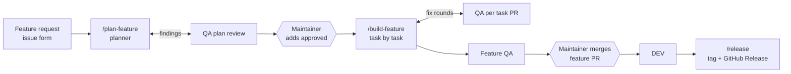

# 0001 The issue-based workflow — The Standard × Agents

2 November 2026 · cjdutoit · **Status: agreed**

> This is the decision record: why the workflow is shaped the way it is, the
> alternatives weighed, and decisions D1–D29. For how to use the workflow day to day,
> read [`Documentation/Procedures/workflow.md`](../Procedures/workflow.md) and
> `DEVELOPERS.md`; where they and this record differ on a detail, they describe what was
> built. Change a decision here by PR, with the reason.

## Purpose and scope

One agent-driven development workflow for every repository created from
**Glory2Him.Template**, built on The Standard (.NET and React). It keeps The Standard's
layer model and testing rules intact, and the Glory2Him rules that tighten them. It
replaces the manual handoffs between agents — briefs copied by hand from one session
to the next — with skills that launch each agent and carry every handover, and it
moves the design out of files and into GitHub issues.

The workflow covers the whole path: a feature request with mockups, its design, user
stories, one task per operation, test-first build, adversarial QA, merge, and release.
The feature, user story and task levels live as GitHub issues; the rules every feature
shares live in one Global Rules issue.

Glory2Him has one maintainer, who works on their own machine with one Claude Pro
account. The workflow is shaped for that: it never needs anyone else's approval, and it never
needs shared infrastructure beyond GitHub and the DEV environment on Azure.

**Out of scope:** stacks other than The Standard, project boards, and deployment
beyond DEV. PROD comes later (D9).

## Why it is shaped this way

The file-based workflow it replaces worked, but every handover was a person copying a
brief from one session to the next, every feature needed a design PR before its tasks
could be signed, and the design documents grew into a second tree that had to be kept
in step with the issues that delivered it. Three things drove the change:

- **Handovers are mechanical.** Who hands what to whom never varied, so a skill can
  do it — and a skill does not forget to brief QA with pointers only.
- **One place for each decision.** A feature's rules, its user stories and its tasks
  are already issues; keeping the design beside them, as issues, leaves one copy to
  keep true and turns every citation into a backlink.
- **A person's time goes on the decisions.** People write the request, answer the
  planner's questions, approve the plan and merge the finished feature. Everything
  between is an agent's, and a build can run unattended for hours.

## Principles

The Standard keeps its rules; an earlier agent-driven project contributes the engine
that moves work between agents. Every principle comes from one of them, or from the
Glory2Him rules already in this template, and the table says which.

| Principle | From | Status |
| --- | --- | --- |
| Layer model, entity count, same-kind orchestration, Florance 2–3 limit | The Standard + Glory2Him overrides | Kept |
| Storage brokers write no query condition; six utility brokers | Glory2Him | Kept (D26, D27) |
| One task = one operation: logic, validation and exception tests together | Glory2Him | Kept |
| FAIL/PASS commit per test; `CATEGORY:` PR titles; no AI attribution | The Standard Team | Kept |
| QA always starts fresh, reads artifacts, never an agent's account | Both | Kept |
| Every QA finding goes to its owner; a sign-off label means no finding is open | Glory2Him | Kept |
| The global rules outrank the issue | Glory2Him | Kept |
| Every handoff is automated: fresh session per unit, worktree, CI wait | Prior workflow | Added |
| Non-interactive runs ask through a `QUESTION:` line and halt | Prior workflow | Added |
| The driver reads `Model - Effort` and launches the session at that effort | New | Added |
| Coordinator sessions stay small: read the issue and reports, relay in ≤ 3 lines | Prior workflow | Added |
| Task body is self-contained: every fact a criterion needs is inline | Prior workflow | Strengthened |
| Plan just in time: a cap on planned, unbuilt work | Prior workflow | Added |
| Test runs are spent carefully: touched projects per task, full suite once | Prior workflow | Added |
| Each task green on CI and merged into the feature branch before the next starts; the feature verified as a whole before `main` | Prior workflow | Added |
| Cost recorded in dollars and in rework per PR | Both | Merged |
| Handover document with external steps, in order | Prior workflow | Added |
| `gh api` (REST) only, never `gh issue`/`gh pr` subcommands | Prior workflow | Enforced |
| Three gates before code (task sign-off, design PR label, design PR merge) | Glory2Him | Simplified to two |
| Manual copy-paste briefs between roles | Glory2Him | Dropped |
| Manual `## Model usage` lines | Glory2Him | Dropped — cost comments replace them |
| Design documents per feature and user story as files | Glory2Him | Moved to issues |

## Where things live

Rules shared by every feature live in one Global Rules issue (D17); everything
feature-specific is a GitHub issue in a parent/child tree. The rule of thumb: if it is
cited by more than one feature, it is a global rule.

| Level | Where | Changed by | Approved by |
| --- | --- | --- | --- |
| Epic intent | `INTENT.md` | PR | Merge |
| Global rules (`ARC`, `SEC`, `EVN`, `DOM`) and the terms | The one open issue labelled `global rules`, filed from its form | A `Change <n>:` comment on it | QA global rules review, then the maintainer's `approved` |
| Decision records | `Documentation/Decisions/NNNN-<slug>.md` | `DESIGN:` PR | Merge |
| Feature | Issue, type **Feature** | Planner edits body | QA plan review, then the maintainer's `approved` |
| User story | Issue, type **User Story**, sub-issue of the feature | Planner | Covered by the feature's approval |
| Task | Issue, type **Task**, sub-issue of its user story | Planner; developer ticks boxes only | QA `ready for development` |
| Mockups | Images uploaded into the feature issue; HTML exports in `Documentation/Mockups/<feature>/` when interaction matters | A person | Superseded by the feature's business rules |
| Documents from before the workflow | `Documentation/Planning/` | A person | Never a source, except for a `legacy` task (D25) |

**The hierarchy uses native GitHub features over REST.** Sub-issues are linked with
`POST /repos/{owner}/{repo}/issues/{parent}/sub_issues` (body `sub_issue_id` = the
child's numeric REST `id`, not its number) and read back with `GET …/sub_issues` and
`GET …/parent`. Issue types are organisation-defined and set with `type` on
`POST …/issues` or `PATCH …/issues/{n}`. Where types are not enabled, labels
`type: feature`, `type: user-story` and `type: task` stand in.

**Citations change shape.** Global rules are still cited by section (`per §SEC2`).
Feature rules are cited by issue and number (`per #500 BR-3`), and user story
operations as `#501 OP-2`. GitHub turns each into a backlink, so a feature shows every
story and task that cites it.

**What the file-based design gave that issues do not, and the replacement:**

| Lost with issues | Replacement |
| --- | --- |
| A PR to review and merge as approval | QA round comment on the feature + `approved` label added by a person |
| An immutable design once merged | QA records a SHA-256 of every body it signs off; the build driver refuses to start if any differs |
| One reviewable change across several documents | The planner posts one `Change <n>:` comment on the feature listing every issue edited; QA reviews that set |
| `grep` for `(needs issue)` | Each user story's operations table compared with its sub-issues through the API |
| `git diff` of design history | Issue edit history in the GitHub UI only (REST does not expose it) |

## End-to-end flow

People write the request, approve the plan and merge the finished feature into `main`;
agents do everything between. `main` only ever receives whole, verified features, and
every merge to `main` deploys to DEV.

In planning, QA's findings loop back to the planner until every task is signed off.
Once the maintainer adds `approved`, the developer starts the build on their own
machine; each task runs in its own session at its labelled effort, and the driver
merges it into the feature branch once QA passes and CI is green. When all tasks are
in, a fresh QA verifies the whole feature before the feature PR goes to the
maintainer. Any `QUESTION:` line or verdict other than PASS halts the build and posts
the question on the feature issue. A legacy feature (D25) enters at the approval step,
after QA's legacy intake in place of the plan review.

## Decisions

Thirty decisions are settled.

| # | Decision | Settled | Why |
| --- | --- | --- | --- |
| D1 | Where the design lives | **In issues:** a Feature, its User Stories and their Tasks, linked as sub-issues; the rules every feature shares in one Global Rules issue (D17). `Documentation/Design/` holds no rules and no feature documents. | One copy of each decision, beside the work that delivers it; citations become backlinks; no design PR per feature. |
| D2 | Where task PRs land | **A feature branch**, `users/<handle>/feature-<n>-<slug>`; the driver merges task PRs into it; the maintainer merges the verified feature to `main` | `main` never holds part of a feature. `build.yml` and `prLinter.yml` run on PRs into `users/*/feature-*` too. |
| D3 | BLOCKING finding mid-feature | **Halt** the build | Tasks build bottom-up and mostly depend on the one before. |
| D4 | Who may approve | **Only a person adds `approved` — never an agent**, on a feature, the Global Rules issue or anything else. With one maintainer there is no two-person rule; the maintainer approves and merges. | Agents act through the maintainer's account, so the label is the one thing an agent must never do. QA's fresh review and the body hashes, not a second identity, protect what was approved. |
| D5 | Tier 3 approval | **The `/tweak` request is the approval**; QA still verifies the PR | A deliberate exception, recorded in `DEVELOPERS.md`; `/tweak` refuses anything that fails the tier 3 test. |
| D6 | Feature-level verification | **A hard gate** before the feature PR leaves draft | Each task was checked alone; nothing else asks whether the feature works as a whole. |
| D7 | Feature PR prefix | **`FEATURES:` / `MAJOR FEATURES:`**, in `prLinter.yml` and `labels.json`, and `FEATURES` added to the non-TDD commit categories. The vendored team-commits skill cannot be edited, so the addition is recorded in `CLAUDE.md`. | No existing category fits work spanning several layers. |
| D8 | The test database | **SQL Server 2025 containers everywhere, through Testcontainers, set up for parity with Azure SQL (`§ARC2`). No separate Azure SQL migration check.** | One engine on developer machines and CI. QA's check of every migration against `§ARC1` is the control; the DEV deployment is where a migration first meets Azure SQL. A dedicated check database is infrastructure a sole maintainer would have to own for little gain before PROD exists. |
| D9 | Environments | **DEV now, PROD later.** Every merge to `main` deploys to DEV on Azure from the repository's own `build.yml`. A release only tags and publishes the GitHub Release; it deploys nothing. PROD will be deployed from a tag through the `Production` environment's required-reviewer approval. **Revisit** when the first repository needs PROD. | DEV is where connection, token and retry handling first meet Azure. A longer chain of environments needs people and infrastructure Glory2Him does not have yet. |
| D10 | Other Azure services in tests | **Emulators for what the solution owns (Azurite, the Service Bus emulator); WireMock only for third parties** | Do not mock what we own; the real broker runs against the emulator, so only configuration differs on Azure. |
| D11 | Where Claude runs | **On the developer's own machine.** Windows with Git Bash is the reference setup; Linux and macOS also work. The driver needs `git`, `gh`, `jq`, `node` and `claude`, and uses nothing Git Bash lacks. Remote Control is optional. | No shared runner and no dedicated build host to provision. The cost is that the machine must stay awake while a build runs. |
| D12 | GitHub identity for builds | **The developer's own account** (`gh auth login`) | Builds run under the person doing the work; there is no bot account to secure. |
| D13 | Claude licence | **One Claude Pro account**, signed in with `/login`. Unattended builds stay: one `claude -p` session per task at its labelled effort, pausing on a usage limit and resuming. | It is what Glory2Him has. Cost comments record the API-equivalent figure, for comparing features and efforts on a subscription, not a bill. |
| D14 | Issue types | **Feature, User Story and Task are organisation issue types; the forms set the type; `type:` labels are the fallback. Sub-issues are required.** The organisation adds **User Story** beside Feature, Task and Bug. | The driver finds a feature's stories and tasks only through sub-issues; types make the tree readable in GitHub. |
| D15 | Merge method | **Merge commits only, enforced on the `main` and `users/*/feature-*` rulesets; squash and rebase off; linear history not required. The rulesets require no reviewer.** | Keeps FAIL/PASS history and the SHAs QA reviewed; one revertable merge per feature on `main`; bisect with `--first-parent` skips the deliberately red FAIL commits. A sole maintainer cannot approve their own PR, so a required reviewer would block every merge. |
| D16 | Releases | **A releaser agent, run on demand with `/release`:** a short-lived `release/vX.Y.Z` branch, a `RELEASES:` PR that QA checks, then `release.yml` tags the release and publishes the GitHub Release with notes and SBOM. SemVer; `Directory.Build.props` the one version source; `CHANGELOG.md`; package and architecture dependency reports. Hotfixes with `/release hotfix <tag>` and `/tweak --base`. | Applies The Standard's SemVer rules to what actually merged, keeps one tagged commit per release, and makes the architecture rules checkable release by release. |
| D17 | Where the global rules live | **One Global Rules issue per repository, filed once from `.github/ISSUE_TEMPLATE/global-rules.yml` and found by its `global rules` label.** It holds the conventions, the Architecture, Security, Events and Domain rules, and the Terms — and, in a moved repository, a Legacy rules index (D30). It changes like an approved plan: `approved` off, the edit, a `Change <n>:` comment, QA's global rules review with a `Signed:` hash, and the maintainer's `approved`. | Every feature starts from an issue form, so the rules every feature adheres to start from one too, with the same approval and audit trail as a plan. QA's plan review refuses a plan whose rules no longer match the hash. |
| D18 | An Epic issue | **No. `INTENT.md` stays the epic, and the Global Rules issue stands alone.** | GitHub allows at most 100 sub-issues per parent, which a long-lived epic would reach; the label finds the rules without a parent. |
| D19 | Who owns `Documentation/` | **`Design/` and `DependencyGraph/architecture.md` are the releaser's output; any other file in `DependencyGraph/` is the repository's own. `Diagrams/` is the user's scratchpad: no agent opens it, and `.claude/settings.json` denies Claude's file tools access. `Mockups/` is the user's. `Planning/` holds documents from before the workflow. `Decisions/` holds decision records.** | Documentation built from drafts drifts from what was approved. A finished diagram is uploaded to the feature issue, and that copy is the source. |
| D20 | The releaser's documentation | **At each release, `Documentation/Design/design.md` (epic level) and `Documentation/Design/Features/<FeatureName>/<FeatureName>.md` with its `assets/`, built only from the issues and their attachments; QA's release check holds every rule, role and diagram to its source** | The formal documentation describes what was released and approved, and is checked like code. |
| D21 | Interviews | **Vendor `grilling` and `grill-me` from `mattpocock/skills`, hash-locked like The Standard. Adapt `grill-with-docs` as this template's own. The planner asks in grilling rounds.** | A recommended answer per question makes a round cheap to answer, asking only the frontier stops guessed follow-ups, and decisions land where the next agent reads them. |
| D22 | A compliance survey | **`/standard-compliance` keeps `improve-codebase-architecture`'s process — scope by hot spots, a visual report, grill one finding — with The Standard's rules in place of deep-module design. It never changes code; its output is a feature request or a `/tweak`.** | Deep-module design would merge the thin layers The Standard requires. The layer check finds the mechanical breaches; sub-agents with each layer's skill find the rest. |
| D23 | Matt Pocock's other skills | **Not installed: `to-spec`, `to-tickets`, `implement`, `tdd`, `code-review`, or his plugin.** | They would run a second workflow beside this one without its approvals; `tdd` would compete with `the-standard-testing` inside a developer session. |
| D24 | Existing documentation | **Kept in `Documentation/Planning/`, never a source. It counts once ported through the issue forms with `/grill-with-docs`; a ported document gets a row in the folder's README naming the issues it became.** | Every feature and rule is logged the same way whatever it started as, and an old document cannot override what was agreed. |
| D25 | Moving an existing repository — the legacy lane | **Move, don't delete:** one rename-only commit puts the old design under `Documentation/Planning/`, keeping sub-paths. The Global Rules issue is filed and approved first. Building the old way stops at the refresh. Every open task signed `ready for development` before the switch — except a design task, which closes as superseded, linking its replacement — is labelled `legacy` and placed under a Feature and a User Story issue created for it, also `legacy`; the user story links its old document by a SHA-pinned URL, and the feature its source — a feature document, a global section, or none, which it says; the task's body is not rewritten. A user story document shared by several features gives one User Story issue per document and feature pair; a sub-feature becomes a legacy Feature of its own, naming the one it extends; a user story document's approved deviations are copied into its User Story issue's `## Deviations`, and a register entry becomes a decision record (D28). QA's legacy intake replaces the plan review; the maintainer adds `approved`; `/build-feature` builds it. A `legacy` task alone is built and verified against the documents it cites, at their Planning path. The planner never adds `legacy`. | Repositories made from the older template hold hundreds of signed tasks. Re-planning them all would stall every repository for weeks; building them against the documents they were signed against keeps what was approved, and the label is the only door through which Planning is read. |
| D26 | Storage brokers write no query condition | **A storage broker composes no query operator and calls no predicate-taking terminal operator, and no broker queries through its `DbContext`. The foundation service authors the condition as a query-shaping function using `System.Linq` only and passes it down; the broker applies it and awaits the result. The query still runs in SQL.** | The query belongs where it can be tested: a keyed read's test executes the query-shaping function against a near-miss set. A broker holds no logic and gets no unit test, so a condition there is logic no test covers. |
| D27 | Utility brokers and Florance | **Six kinds of utility broker — logging, DateTime, identifier, identity, events, access — carry no entity's data, and any service, an orchestration included, may hold them. Every other broker is off limits to an orchestration. No broker counts toward the two-to-three; a fourth service means a split under a coordination service. `scripts/utility-brokers.txt` seeds the class names from the Template, and each repository adds its own in `Documentation/DependencyGraph/utility-brokers.txt`, which no refresh touches.** | One explicit list, the same everywhere, ends the argument over which broker an orchestration may hold. It deliberately overrides parts of The Standard, and the agents carry the reasoning. |
| D28 | Deviations without a user story | **A service designed before the switch, whose deviation sat in an architecture document's register, gets a decision record carrying `**Deviation:** <ClassName> — <the rule>`.** | `scripts/list-deviations.sh` finds it there, so the layer check excuses an argued exception and still reports an overage nobody approved. |
| D29 | A test that passes first time | **Pinned, not forced to fail:** prove it can fail by breaking the production code it covers and reverting, commit it alone as `{TestName} -> PASS`, and name it in the PR. QA re-runs at least one such break. | "No production code without a failing test" stays unqualified; changing production code to make a test fail first would be code no criterion asked for. |
| D30 | Rules too large for an issue | **A moved repository may file the Global Rules issue lean.** Its **Legacy rules** section indexes every section of the old rule documents, one line each: number (with the old number where the document records one), title, and its own link pinned to a SHA at the Planning path. An unstruck line binds legacy features only; a new feature that needs one stops until `/grill-with-docs` settles it. A line is never deleted: it is struck as `(ported)`, distilled under its own number with its sub-section numbers; `(retired: <reason>)`, for history, a map or conventions; or `(feature: #<n>)`, binding only that legacy feature. A new repository numbers flat; a moved one keeps its own scheme. `§ARC1`–`§ARC5` are always present, in full, and their numbers reserved, because the agents cite them by number: an indexed rule never covers one, a repository's own rule already using one takes the next free number, marked `(formerly §ARCn)`, and a conflict with one goes to the maintainer. | An issue body holds 65,536 characters, and a repository's rules can run to more than a megabyte. Porting a large rule set in one sitting would stall the repository; keeping the numbering keeps every existing citation resolving; and sections that are not global rules need an end other than porting, or the lane deadlocks. |

## Risks

- **A sole maintainer approves their own plans.** Nobody else reads a plan before
  it is built. Two controls stand in: QA reviews every plan in a fresh context, with no
  account of the planner's reasoning, and withholds its sign-off while any finding is
  open; and QA's body hashes freeze what was signed, so the driver refuses to build a
  plan that changed after review.
- **Usage limits on one Pro account slow builds.** A long feature pauses on a limit
  and resumes on its own, so it finishes later rather than failing. Effort labels are
  the lever: the default is `High`, and the top rungs are kept for the cases that need
  them.
- **Builds run on one machine.** It must stay awake and online for hours; CI, not the
  machine, is the arbiter of green.
- **No migration check against Azure SQL before `main`.** A migration Azure SQL
  rejects is first caught on the DEV deployment. `§ARC1`, cited on every storage user
  story and checked by QA on every migration, is the control.
- **Feature branches live as long as the feature.** The planner's feature size gate is
  the control; every merge of `main` into the feature is a chance to halt.
- **The feature PR is large.** Each task passed QA and the feature passed feature QA,
  so the maintainer's review is about integration and the handover.
- **Issue types and sub-issues need organisation settings.** Sub-issues have no stand-in
  and must be enabled before the first plan.
- **Body hashes break on any edit,** including a typo fix. That is intended, but a small
  correction costs a QA round.
- **D5 weakens the approval chain for tier 3.** `/tweak` must refuse anything failing
  the tier 3 test; QA's PR review is the only independent check.
- **The legacy lane keeps two sources of design alive for a while.** Only a task
  labelled `legacy` reads Planning, only the person moving the repository adds the
  label, and the intake checks each legacy feature against the approved global rules.
  An unstruck legacy rule (D30) binds legacy features only, and the planner and QA
  stop a new feature that touches one until it is settled.

## Credits

`grilling` and `grill-me` are vendored from Matt Pocock's
[`mattpocock/skills`](https://github.com/mattpocock/skills), under the MIT licence.
`grill-with-docs` and `standard-compliance` are adapted from the same repository; each
carries its credit in its folder's `CREDITS.md`.
