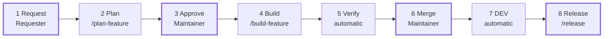

# Development workflow — who does what

How work goes from a feature request to a release: who does each step, what each
step leaves behind, and what to run. `DEVELOPERS.md` gives the reasoning behind it,
and [`Documentation/Decisions/0001-issue-based-workflow.md`](../Decisions/0001-issue-based-workflow.md)
records the decisions.

Three walkthroughs sit beside this page, for the developer at the keyboard:

- [new-feature.md](new-feature.md) — a new feature, step by step: what to type in
  Claude Code at each step, how to answer the question rounds, and what you will see.
- [porting-planning-documents.md](porting-planning-documents.md) — turning an existing
  document in `Documentation/Planning/` into feature requests and global rules with
  `/grill-with-docs`, and getting those features built.
- [migrating-an-existing-repository.md](migrating-an-existing-repository.md) — moving a
  repository made from the older template onto this workflow, its signed tasks
  included.

## Overview

People do four things: write the feature request, answer the planner's questions,
approve the plan, and merge the finished feature. Agents do everything in between, and
skills pass the work from one agent to the next, so nobody copies briefs between
sessions.



In planning, the planner and QA loop until the plan is clean. In the build, each task
loops between the developer agent and QA until it passes. Neither loop needs a person
unless a question comes up. Every merge to `main` deploys to DEV. A release tags the
code and publishes the GitHub Release; it deploys nothing. PROD comes later.

The workflow applies to every repository made from Glory2Him.Template and follows The
Standard throughout. `main` only ever receives whole features that have been verified
end to end.

**Where things live:**

| What | Where | Changed by |
| --- | --- | --- |
| What the product is for | `INTENT.md` | PR |
| Rules every feature inherits (`§ARC`, `§SEC`, `§EVN`, `§DOM`) and the terms they use | The one open issue labelled `global rules` | A `Change <n>:` comment, QA's global rules review, the maintainer's `approved` |
| Decisions hard to reverse, and the deviations of services designed before this workflow | `Documentation/Decisions/NNNN-<slug>.md` | `DESIGN:` PR |
| A feature, its business rules `BR-n` | GitHub issue, type **Feature** | The form, then the planner |
| A user story, its operations `OP-n` | GitHub issue, type **User Story**, sub-issue of the feature | Planner |
| A task, one operation | GitHub issue, type **Task**, sub-issue of the user story | Planner; the developer only ticks boxes |
| Code | Task branch → feature branch → `main` | Developer agent, through PRs |
| Release notes | `Documentation/Releases/vX.Y.Z.md` | Releaser agent |
| The formal documentation — the epic page and one page per released feature, with its images | `Documentation/Design/` | Releaser agent, from the issues, at each release |
| The layer graph | `Documentation/DependencyGraph/architecture.md` | Releaser agent, at each release |
| Draft diagrams | `Documentation/Diagrams/` | You — no agent opens it; finished diagrams go on the feature issue |
| Existing documents from before this workflow | `Documentation/Planning/` | You — never a source, except for a `legacy` task; each is ported through the Feature request form and the Global Rules issue with `/grill-with-docs`, then recorded in its README |
| UI wireframes and Claude Design exports | `Documentation/Mockups/` | You |

The rule of thumb: if more than one feature cites a rule, it is a global rule, on the
Global Rules issue. Every feature adheres to it, and a departure needs a documented
reason in the user story's **Deviations**. Everything else about a feature lives in its
issues.

**Where it runs:** Claude Code runs on the developer's own machine — Windows with Git
Bash is the reference setup; Linux and macOS work too — signed in with the
developer's Claude Pro account and their own GitHub account. There is no shared
runner. Remote Control is optional, for following a long build from another device.

## Roles

There are three human roles and four agents. Glory2Him has one maintainer, who may
hold every human role. The one rule about people: **only a person adds `approved` —
never an agent.**

### People

| Role | Who | Does | Never |
| --- | --- | --- | --- |
| **Requester** | Anyone | Raises the feature through the issue form; answers the planner's question rounds on the issue, or is grilled on the request with `/grill-with-docs` | Writes the plan or the tasks |
| **Developer** | Whoever owns the feature | Runs `/plan-feature` and `/build-feature` on their machine; answers halts; may work on any branch by hand | Lets an agent add `approved` |
| **Maintainer** | The repository's maintainer | Reads the planned feature and adds `approved`, and the same for a change to the Global Rules issue; merges the feature PR and the `RELEASES:` PR with a merge commit; runs `/release` and confirms the version | Squashes or rebases |

### Agents

Each agent is defined in `.claude/agents/`. It always starts in a fresh session and
knows only what the issues and the code say.

| Agent | Started by | Reads | Writes | Never |
| --- | --- | --- | --- | --- |
| **planner** | `/plan-feature` | The feature request and its `Settled before planning` and `Answers round` comments, the Global Rules issue, the code | The feature's design sections, user story and task issues, question rounds with a recommended answer each | Writes code, tests or any repository file; applies `ready for development`, `approved` or `legacy` |
| **developer** | `/build-task`, `/tweak`, `/verify-feature` | The task, its user story, its feature, the Global Rules sections they cite — and, for a `legacy` task, the documents it cites through the Planning mapping; nothing else | Tests first (`-> FAIL`, then `-> PASS`), code, the PR into the feature branch | Starts without `ready for development` and `approved`; builds anything not in a criterion |
| **qa** | Every skill, after each step | The issues and the code, never another agent's account | Numbered round comments with BLOCKING / ADVISORY findings, each with its owner; `ready for development`, `ready for review` | Fixes anything; applies a sign-off label while a finding is open |
| **releaser** | `/release` | Everything merged since the last tag, `INTENT.md`, the Global Rules issue, the feature issues and their attachments | Version, changelog, `Documentation/Design/`, `Documentation/DependencyGraph/architecture.md`, release notes, the `RELEASES:` PR | Edits code; documents from `Documentation/Diagrams/`; chooses the version alone; merges, tags or deploys |

QA works in six modes:
- **global rules review**, on each change to the Global Rules issue;
- **plan review**, before any code;
- **legacy intake**, in place of a plan review for a `legacy` feature;
- **change verification**, on each task PR;
- **feature verification**, on the whole feature branch;
- **release check**, on the release PR — the generated documentation held to its
  sources.

Every QA finding goes to its owner — implementation to the developer; missing or
contradictory criteria, or a design that got a boundary or a layer wrong, to the
planner. A failure that looks unrelated or pre-existing is a finding for its owner
too, never silently fixed or ignored.

Three skills are interviews with a person, never run by the driver:
- **`/grill-with-docs`** — grills you in rounds and writes what settles: terms and rules
  to the Global Rules issue, decision records, `INTENT.md`, or a `Settled before
  planning` comment on a feature;
- **`/grill-me`** — the same interview, nothing written down;
- **`/standard-compliance`** — surveys the code for breaches of The Standard and the
  global rules, then grills you on one and drafts a feature request for you to file through
  the form, or words a `/tweak`.

## Artefacts

Each artefact below is created by the role named, at the step named. Nothing passes
between agents in conversation. If it isn't in one of these artefacts, it doesn't
exist.

| Artefact | Created by | When | Holds |
| --- | --- | --- | --- |
| **Feature issue** | Requester, through the form | Step 1 | Summary, who uses it, Given/When/Then behaviour, what must not happen, mockups, data, done when, out of scope, deadline |
| **Feature design sections** (in the feature issue, below the request) | Planner | Step 2 | Problem, business rules `BR-1`…, user stories table, entity count, event contracts, storage and migration, security, risks, out of scope, deviations, open questions |
| **`Settled before planning` comment** | `/grill-with-docs` | Before step 2, optional | The decisions made with the requester, numbered |
| **`Questions round <r>` comment** | Planner | Step 2, if needed | The questions it can ask now, numbered, each with a recommended answer |
| **`Answers round <r>` comment** | `/plan-feature` | Step 2, after each round | The answers, against their question numbers |
| **User story issue** (sub-issue of the feature) | Planner | Step 2 | Parent, level, interface, cited rules, Operations table `OP-n` → task |
| **Task issue** (sub-issue of the user story) | Planner | Step 2 | Tier; Feature, User story + `OP-n`, Operation, Branch, Depends on; outcome; acceptance checklist (logic happy and negative paths, validation, exceptions); design facts inline; labels `Model - Effort`, `design: <area>` |
| **`Plan QA round N` comment** | QA | Step 2, each round | Findings, and on the final round a `Signed:` line with a hash of every feature, story and task body |
| **`Spec cost:` comment** | `/plan-feature` | End of step 2 | Planning cost in dollars, model and effort per agent |
| **`approved` label** | The maintainer | Step 3 | The decision to build |
| **Feature branch + draft PR** `FEATURES: <title>` | Build driver | Start of step 4 | Branch `users/<handle>/feature-<n>-<slug>`; PR body `Closes #<feature>` |
| **Task branch + PR** into the feature branch | Developer agent | Step 4, per task | FAIL/PASS commits; body `Closes #<task>` + Decisions not in the task |
| **`QA round N` comment** on each PR | QA | Step 4, per round | Verdict, BLOCKING / ADVISORY findings, `MERGE READY: YES/NO`, the commit reviewed |
| **`Build cost:` comment** on each task | `/build-task` | Step 4, per task | Dollars across every attempt, model/effort per agent, developer runs, QA rounds, round-1 BLOCKING count |
| **`Build progress` comment** | Build driver | Step 4, throughout | One line per milestone |
| **`Feature QA round N` comment** | QA | Step 5 | Feature-level findings; `FEATURE PASS` |
| **`Handover:` comment** | `/verify-feature` | Step 5 | Migrations and their order, configuration and secrets, irreversible steps, open ADVISORY findings, total cost |
| **Release branch + `RELEASES: vX.Y.Z` PR** | Releaser | Step 8 | Version in `Directory.Build.props` and `package.json`; `CHANGELOG.md`; `Documentation/Design/` — `design.md` and `Features/<FeatureName>/`; `Documentation/DependencyGraph/architecture.md`; the package report; `Documentation/Releases/vX.Y.Z.md` |
| **Tag `vX.Y.Z` + GitHub Release + SBOM** | Release workflow | Step 8 | The notes, and a CycloneDX SBOM generated from the tagged tree |

## Step by step

Eight steps take a request to a release. Unless a step says otherwise, its command
runs in Claude Code on the developer's own machine, inside the repository.

### 1. Request — Requester

1. In GitHub: **Issues → New issue → Feature request**.
2. Fill in every required field. Write the behaviour as Given/When/Then scenarios,
   including the awkward cases (empty, too many, someone else's record).
3. Drag mockup images into the Mockups field. A Claude Design HTML export goes in
   `Documentation/Mockups/<feature-slug>/` in a `DOCUMENTATION:` PR, and the issue links
   to it by a URL pinned to the commit.

The issue gets type **Feature**, `type: feature` and `status: needs-design`.

Starting from an existing document rather than a blank form? Port it first, as
[porting-planning-documents.md](porting-planning-documents.md) describes.

### 2. Plan — the developer runs it; the planner and QA do it

```
/plan-feature <feature-issue>
```

1. The planner writes the design sections into the feature issue, opens the user story
   and task sub-issues, and links them.
2. If the planner has questions, it posts one `Questions round <r>` comment and stops:
   each question numbered, with its recommended answer. The skill shows you the round
   whole. "Yes" accepts a recommendation; write out only what you would decide
   differently. The skill posts the answers as `Answers round <r>` and relaunches the
   planner, which asks another round only if the answers opened new questions.

   To start with fewer rounds, run `/grill-with-docs <feature-issue>` with the requester
   first: it posts what you settle as a `Settled before planning` comment, which the
   planner reads as answers.
3. A fresh QA reviews the whole plan. Its findings go back to the planner, and they go
   round again until QA passes the plan with no finding open.
4. When the plan passes, QA:
   - labels every task `ready for development`;
   - records the `Signed:` hashes;
   - moves the feature to `status: awaiting-approval`.

   The skill then posts `Spec cost:`.

If the feature needs a new global rule, the skill stops. Change the Global Rules issue
first with `/grill-with-docs`: it posts the `Change <n>:` comment and runs QA's global
rules review, and the maintainer adds `approved` again. Then run `/plan-feature`
again.

A `legacy` feature is not planned in this step: it was planned before the switch, so
`/plan-feature` runs QA's legacy intake in place of the planner and the plan review
([migrating-an-existing-repository.md](migrating-an-existing-repository.md)).

### 3. Approve — the maintainer

1. Read the feature issue: the business rules, the user stories, the security section,
   the risks and the deviations. Skim the tasks.
2. Add the label `approved` to the feature issue.

Only a person adds `approved`; no agent ever does. What you approved is protected by
QA's `Signed:` hashes: the build refuses to start on a body that changed after QA
signed it.

### 4. Build — the developer runs it; the driver, the developer agent and QA do it

On your machine — in a Remote Control session if you want to follow it from another
device:

```
/build-feature <feature-issue>
```

The skill checks the gates, shows the build order, and starts the driver in the
background. The driver works through the tasks in order: groundwork, broker,
foundation, processing, orchestration, exposer, UI, then **Depends on**. For each task:

1. If `main` has moved, the driver brings it into the feature branch through a
   short-lived PR and waits for green CI.
2. It checks that the task, story and feature bodies still match QA's hashes.
3. It runs `claude -p "/build-task <n>"` at the task's `Model - Effort` level, in the
   task's own worktree. That session runs the developer agent, opens a PR into the
   feature branch, waits for CI, gets a fresh QA review, runs any fix rounds and posts a
   `Build cost:` comment.
4. On `QA PASS` and green CI, it merges the task PR with a merge commit, at the exact
   commit QA and CI saw, and marks the task `status: done`.

Follow progress in the `Build progress` comment on the feature issue, or in the
coordinating session. You don't need to do anything else unless the build halts.
Leave the machine awake while it runs.

### 5. Verify the feature — automatic

When every task is in, the driver runs `/verify-feature` at max effort. A fresh QA
checks that:
- every `BR-n` has an acceptance test through the API;
- every role in the security section is tested, both allowed and refused;
- the full suite passes;
- each migration applies as a single batch to an empty container database.

Developer findings become a fix PR into the feature branch, for at most two rounds.

On `FEATURE PASS`:
- QA labels the feature PR `ready for review`;
- the `Handover:` comment is posted;
- the driver puts the handover and a `Closes` line for every issue in the PR body, and
  takes the PR out of draft.

### 6. Merge — the maintainer

1. Review the feature PR for integration and check the handover: migrations and their
   order, configuration and secrets, open ADVISORY findings, and cost.
2. Merge it with **Create a merge commit**. Never squash or rebase.

The feature, its stories and its tasks close.

### 7. DEV — automatic

The merge to `main` deploys to **DEV**, on Azure, from the repository's own
`build.yml`. DEV is where a migration first meets Azure SQL, and where connection,
token and retry handling first meet Azure.

### 8. Release — the maintainer

When you want to ship what has merged since the last tag:

```
/release
```

1. The releaser proposes the version with its evidence: MAJOR for a broken public
   contract, MINOR for any feature, PATCH for fixes only. **Confirm it or correct it.**
2. It cuts `release/vX.Y.Z`, writes the version, docs, changelog, dependency reports and
   release notes, and opens `RELEASES: vX.Y.Z`.
3. A fresh QA checks the release PR.
4. You merge the `RELEASES:` PR with a merge commit.
5. The release workflow tags `vX.Y.Z` and publishes the GitHub Release with the notes
   and an SBOM. It deploys nothing.

PROD comes later: it will be deployed from a tag, through the GitHub `Production`
environment's required-reviewer approval.

## Small changes and hotfixes

**Tier 3 — a bug fix, copy or styling change** in one file, with no schema, event,
security boundary or new behaviour, skips planning and approval. Your request is the
approval. QA still verifies the PR, and you merge it.

```
/tweak <what to change>
/tweak <issue-number>
```

1. The skill checks that the change really is tier 3. If it isn't, it stops and
   suggests how to split it.
2. It opens a cut-down task labelled `tier: 3` that records `Requested by @<you> via /tweak`.
3. One developer agent builds the change on `users/<handle>/fix-<slug>` from `main`, test
   first. CI runs, QA verifies, and a `Tweak cost:` comment is posted.
4. You merge the PR into `main` with a merge commit.

**Hotfix** — when a released version needs a fix but `main` holds unreleased features:

```
/release hotfix <last-tag>
/tweak --base release/vX.Y.(Z+1) <the fix>
/release hotfix <last-tag>
```

1. `/release hotfix` cuts `release/vX.Y.(Z+1)` from the last tag, and stops.
2. `/tweak --base` builds the fix against that branch.
3. `/release hotfix` again: the releaser finishes the release as usual on that branch.
   Its `RELEASES:` PR into `main` tags the fix on its own and brings it into `main`, in
   one merge.

## When things stop

**A halt** means the build needs a person. The driver posts a `Build halted:` comment on
the feature issue and labels the feature `status: blocked`.

| The halt says | Cause | What you do |
| --- | --- | --- |
| `#n asked: …` | A build session reached something only a person can decide | Answer on the issue. If the answer changes the plan, change the plan (below) |
| `#n: Build cost: … QA FAIL` | QA failed the task after three rounds, or a finding belongs to the planner | Read the last `QA round` on the PR, then fix the task or the plan |
| `the latest QA round … is not a PASS` / `QA passed … but … head is …` | Someone pushed to the task PR after QA ran | Re-run; the task goes back through QA |
| `#n changed after QA signed it` | A body was edited after approval | Change the plan properly (below), or revert the edit |
| `main conflicts with …` | `main` and the feature branch changed the same lines | Merge `main` into the feature branch yourself, through a PR |
| `CI red … a cross-task break` | Two tasks pass alone and fail together | Fix it in a PR into the feature branch |

Then run `/build-feature <feature-issue>` again. It skips tasks that are already
`status: done` and picks up any task whose PR is already open.

**A pause** is not a halt. When the build hits a Claude usage limit, the driver posts
`paused until <time>`, waits 30 minutes and retries the same session, up to 16 times.
You don't need to do anything.

**Changing an approved plan:**

1. The planner (or you) removes `ready for development` from each affected task and
   `approved` from the feature.
2. The planner edits the issues and posts one `Change <n>:` comment on the feature,
   listing every issue it changed.
3. Hand it back to QA in a fresh Claude Code session with
   `Act as QA, reviewing the plan for feature #<n>.` QA reviews what the `Change <n>:`
   comment lists and signs again.
4. You add `approved` again, and re-run `/build-feature`.

A `legacy` task is never edited this way: a change to its design is new work, through
`/grill-with-docs` and `/plan-feature`.

## Command reference

Every command runs on the developer's own machine, in the repository. Type the skills
into Claude Code and the scripts into Git Bash (or your shell on Linux or macOS).

### Skills

| Command | Who runs it | When | Ends with |
| --- | --- | --- | --- |
| `/grill-with-docs [n \| area]` | Developer, with the requester | A new repository; a feature before planning; a rule or term to change | Terms and rules on the Global Rules issue (then QA and the maintainer's `approved`), decision records, `INTENT.md`, or a `Settled before planning` comment |
| `/grill-me` | Anyone | A plan or decision to stress-test | A shared understanding, nothing written |
| `/plan-feature <n>` | Developer | A feature is at `status: needs-design` | `status: awaiting-approval`, or a question round to answer |
| `/build-feature <n>` | Developer | The feature carries `approved`; also to resume after a halt | The feature PR ready for review, or a halt |
| `/tweak <request>` | Anyone | A tier 3 change | A PR to `main` for the maintainer to merge |
| `/tweak --base release/vX.Y.(Z+1) <fix>` | The maintainer | A hotfix | A PR into the release branch |
| `/release` | The maintainer | Ready to ship what has merged since the last tag | A `RELEASES:` PR to merge |
| `/release hotfix <tag>` | The maintainer | A hotfix while `main` holds unreleased work | A release branch cut from the tag |
| `/standard-compliance [area]` | Developer | Periodic upkeep, or before a big feature in the same area | An HTML report, then one feature request or `/tweak` for the finding you pick |
| `/build-task <n>` | The driver (rarely by hand) | Each task in a build | `QA PASS` or `QUESTION:` |
| `/verify-feature <n>` | The driver | Every task merged | `FEATURE PASS` and the handover |

### Scripts

| Command | When |
| --- | --- |
| `bash scripts/progress.sh` | To see every feature by status |
| `node scripts/token-usage.mjs --current` | To see what the current session has cost |
| `node scripts/token-usage.mjs --worktree` | To see what every session in this worktree has cost |
| `node scripts/prune-merged-worktrees.mjs --apply` | When the disk has under 10 GB free, or the driver asks |
| `python3 scripts/architecture-graph.py --check` | To draw the layer graph and list rule violations |
| `python3 Documentation/ModelBudget/tally.py` | To review what each effort level cost and how many fix rounds it took |
| `node --test scripts/*.test.mjs` | After changing a workflow script |

### In GitHub

| Action | Who | When |
| --- | --- | --- |
| New issue → Feature request | Requester | Step 1 |
| Add the label `approved` | The maintainer | Step 3 |
| Merge the feature PR (merge commit) | The maintainer | Step 6 |
| Merge the `RELEASES:` PR (merge commit) | The maintainer | Step 8 |

## Labels and statuses

Two labels are approvals, and they are never applied by whoever did the work:
`ready for development` (QA, per task) and `approved` (the maintainer, per feature —
only a person, never an agent). Every other label is a status, and the skills move it.

**A feature moves:** `status: needs-design` → `status: in-plan-review` →
`status: awaiting-approval` → `approved` → `status: building` →
`status: in-feature-qa` → `status: done` once feature QA passes and the PR waits for the
maintainer → closed when the feature PR merges. It carries
`status: blocked` while a halt waits on a person.

**A task moves:** `status: needs-scoping` → `ready for development` →
`status: in-progress` → `status: done` when merged into the feature branch.

| Label | On | Applied by |
| --- | --- | --- |
| `type: feature`, `type: user-story`, `type: task` | Issues | The form and the planner (a fallback where issue types are not enabled) |
| `global rules` | The Global Rules issue | Its form |
| `status: needs-design` | Feature | The form |
| `status: in-plan-review` | Feature | `/plan-feature` |
| `status: needs-scoping` | Task | Planner |
| `ready for development` | Task | QA only |
| `status: awaiting-approval` | Feature, the Global Rules issue | QA |
| `approved` | Feature, the Global Rules issue | The maintainer only — never an agent |
| `status: building`, `status: in-feature-qa`, `status: blocked`, `status: done` | Feature | The build driver |
| `status: in-progress`, `status: done` | Task | The build driver |
| `ready for review` | Task, feature and release PRs | QA only |
| `tier: 3` | Task | `/tweak` |
| `legacy` | Feature, user story and task from before the switch | The person moving the repository, once — never the planner |
| `Opus 5.5 - Low` … `Max` | Task | Planner; the driver runs the task at that effort |
| `design: <area>` | Task | Planner, one per global rule area touched |

**Effort.** The model is always Opus 5.5; only the effort varies. Developer work
defaults to `High`. The planner raises it to `Extra` or `Max` for:
- a component that is the first of its kind;
- a breadth sweep;
- the security boundary;
- migrations and SQL;
- thin criteria.

It lowers it to `Low` or `Medium` for trivial work.

## Before first use

These are done once per organisation, repository or person. `README.md` in each new
repository carries the full checklist.

| Who | What |
| --- | --- |
| Organisation owner | Add the issue type **User Story** beside Feature, Task and Bug, and enable sub-issues — sub-issues are required |
| Repository admin | Run **Actions → Labels → Run workflow** once |
| Repository admin | Rulesets on `main` and `users/*/feature-*`: PR required, `Build` check green, merge commits only (squash and rebase off), no required reviewers |
| Repository admin | Environment `Development` (DEV) with its OIDC identity variables; environment `Production` with a required reviewer, kept for later |
| Each developer | On their machine: `git` and Git Bash, `gh`, `jq`, `node`, `claude`, the .NET SDK and Docker; `/login` with their Claude Pro account, and `gh auth login` with their own account |
| The maintainer | File the **Global rules** issue from its form, then `/grill-with-docs` to write `INTENT.md` and the first real rules and terms; QA reviews them and the maintainer adds `approved`. Until then `/plan-feature` refuses to start |
| The maintainer, for an existing repository | Follow [migrating-an-existing-repository.md](migrating-an-existing-repository.md) instead of starting from an empty Global Rules issue |
